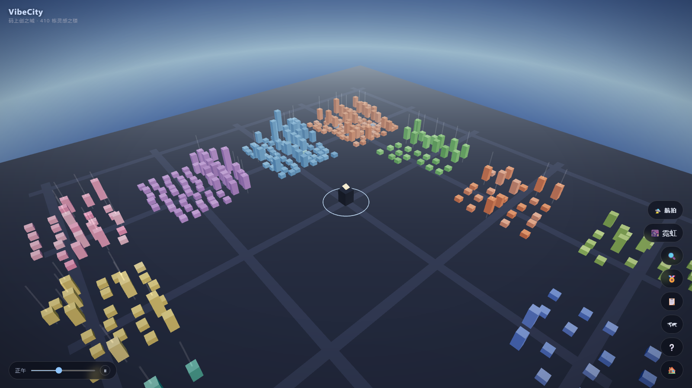
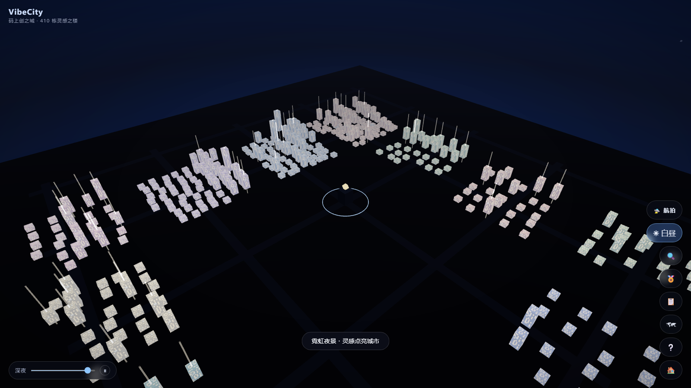
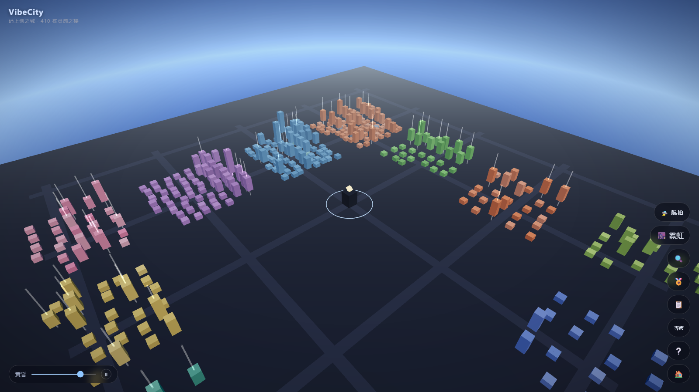
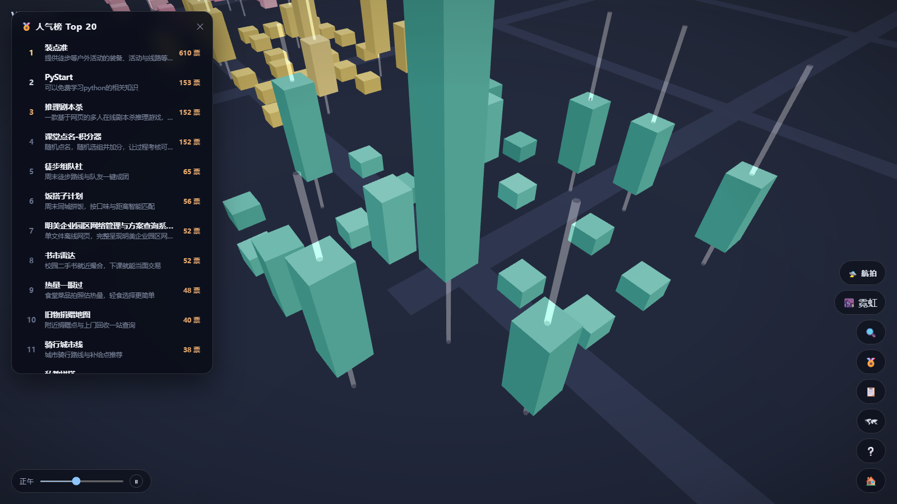

# VibeCity · 码上创之城

> 把 **453 份大赛投稿**，程序化生成一座**可以走进去的 3D 城市**。
> 每个项目一栋楼，分类即街区，票数即楼高——走进 VibeCity，看见灵感的模样。

> [!WARNING]
> **本项目为大赛作品的可视化索引与展示，非官方产品。**
>
> - **数据来自 CSDN「码上创 vibe building」大赛公开接口**，抓取时点为 2026-11，非实时
> - **票数、评分、分类均为上游接口原值**，可能随主办方调整而变化
> - 项目名称、简介、评分、票数**版权归大赛主办方及各作者所有**，本页仅作索引展示与直达链接
> - 楼高为**可视化映射**（`√票数 × 1.9 + 评分 × 2.4`），不代表官方排名
> - 详见 [数据来源与使用限制](#-数据来源与使用限制)

[](https://opensource.org/licenses/MIT)
[]()
[]()
[]()
[]()
[]()

<p align="center">
  <br>
  <sub>白昼航拍：411 栋灵感之楼 · 14 个主题街区 · 程序化窗格幕墙</sub>
</p>

<p align="center">
  
  
</p>
<p align="center">
  <sub>左：启动页（411 栋 / 2385 票 / 14 街区） · 右：霓虹夜景（42% 窗格点亮 + beacon 光柱）</sub>
</p>

---

## ✨ 核心特性

### 🌱 城市生成

- **一项目一楼**：453 份投稿同名去重后 **411 栋楼**，楼高映射人气与口碑
- **14 个主题街区**：生活 / 校园 / 游戏 / 社交 / 健身 / 公益 / 户外 / K12 / 研发 / 个人效率 …
- **26 类语义产业带**：街区内按「记账理财 / 学习答题 / AI 助手 …」聚类，相似项目自然相邻（语义覆盖率 **88.8%**）
- **Top60 beacon 光柱**：人气之楼顶立全城可见光柱，呼吸式明灭
- **中心广场**：大赛纪念碑 + 旋转统计宝石
- **城市生长动画**：入城时 411 栋楼从地面长起（实例化缩放插值 + easeOutCubic）

<p align="center">
  <br>
  <sub>黄昏：大气散射 shader 驱动的霞光带 + 全城暖色受光</sub>
</p>

### 交互

| 功能 | 说明 |
|---|---|
| 航拍 / 漫游 | `🛸` 轨道相机 ↔ `🚶` 第一人称（`WASD` 走 · `空格` 跳 · `Esc` 回航拍） |
| 楼宇点击 | Raycaster 精确拾取 `instanceId` → 项目卡，带拖拽/飞行防误触 |
| 项目卡 | 四维评分条（创意/完整/实用/体验）+ 票数 + 分类 + 直达作品 + 复制定位深链 |
| 搜索飞行 | 输入项目名，相机平滑飞至楼顶并弹卡 |
| 街区导览 | 14 个分类芯片，点击飞往对应街区上空 |
| 人气榜 | Top 20，点击行内跳转对应楼宇 |
| 项目列表 | `📋` 键盘可达：`Tab` → `↑↓` → `Enter` 定位，`aria-live` 播报 |
| 昼夜控制 | 时间滑杆手动定格 + `⏸` 自动流动（一轮约 52 秒） |
| 霓虹切换 | `🌆` 白昼 / 赛博夜景（窗灯矩阵 + 光柱增强） |
| 深链分享 | `#项目名` 直达该楼，含白名单校验防注入 |
| 帮助面板 | `❔` 完整操作指南 |
| 性能面板 | `F3` 实时 FPS / draw calls / 三角面 / 几何与纹理内存 |
| 偏好持久化 | 昼夜时刻 / 霓虹 / 视角刷新后自动还原 |
| 低配逃生舱 | `?lite=1` 强制低配；设备信号自动降级；连续低帧自动降分辨率 |

<p align="center">
  <br>
  <sub>项目卡：四维评分条 · 票数 · 分类 · 复制定位深链 · 直达作品</sub>
</p>

<p align="center">
  
  
</p>
<p align="center">
  <sub>左：人气榜 Top 20（点击跳转） · 右：街区导览（14 分类飞行）</sub>
</p>

### 渲染

| 层 | 技术 |
|---|---|
| 色彩 | ACES Filmic 色调映射 + sRGB 输出 + 曝光补偿 |
| 天空 | 单片 GLSL：Rayleigh 散射 + Mie 前向散射 + 太阳盘光晕 + 昼夜插值 + 夜间星点 |
| 城市 | 14 街区各一 `InstancedMesh` —— **411 栋楼仅 33 draw calls** |
| 楼面 | Canvas 程序化窗格纹理 → `emissiveMap`（白昼幕墙 / 霓虹点亮） |
| 楼顶 | 天线 + 水塔实例化（各 1 个 draw call） |
| 阴影 | 柔和阴影贴图 + 地形接收 |
| 降级 | `?lite=1` / 设备信号 / 帧率自适应三级降 |

---

## 🚀 快速开始

### 方式一：直接用浏览器打开

```bash
git clone https://github.com/DeXuan/vibecity.git
cd vibecity
# 双击 index.html 即可（完全离线，无需服务器）
```

### 方式二：本地服务器（推荐，避免部分浏览器的 file:// 限制）

```bash
python -m http.server 8000
# 打开 http://localhost:8000/index.html
```

> 单文件自包含：Three.js r160 已内联，**零外部请求、零 CDN 依赖**，断网可用。
> 刻意不使用 ES Module —— `import` 在 `file://` 下会被 CORS 拦截，破坏「双击即开」。模块化由**构建期契约校验**保证。

### 方式三：直接访问在线演示

- 国内直连：<https://xn--888-vw3e05fxyzc07e.cn:9006/web/vb-city/>
- GitHub Pages 镜像：<https://dexuan.github.io/vibecity/>

---

## 📊 数据规模

| 指标 | 数值 |
|---|---|
| 原始投稿 | **453** 份 |
| 去重后独特项目 | **411**（同名取最高票） |
| 主题街区 | **14** |
| 语义产业带 | **26** 类规则 → 21 组实际生效 |
| 语义覆盖率 | **88.8%**（「其他」仅 11.2%） |
| 总人气票 | **2,385** |
| 人气王 | 「装点准」**610 票**（徒步装备管理） |
| 带作品链接 | 411 / 411 |
| 带四维评分 | 122 |
| 单文件体积 | **795 KB**（gzip 后约 260 KB） |
| Draw calls | **33** |
| 三角面 | ~14k |
| 纹理数 | 1（程序化窗格，全楼共享） |

**分类分布**：生活 94 · 校园 72 · 游戏 61 · 社交 28 · 健身 27 · 公益 26 · K12 25 · 户外 24 · 个人效率 17 · 研发 16 · 学习科研 8 · 面试路演 7 · 其他 4 · 纪念代码 2

**语义 Top6**：游戏娱乐 71 · 学习答题 50 · AI 助手 43 · 运动健康 37 · 校园教务 28 · 日程待办 25

内置技术栈：Three.js r160（MIT）单文件内联，无构建步骤、无依赖安装。

---

## 🗂 项目结构

```
vb-city/
├── index.html                  # ★ 构建产物（单文件应用，795 KB）
├── build.py                    # 构建：src/* + three.js → index.html（三重校验）
├── src/
│   ├── 01_style.css            # 深色都市风样式
│   ├── 02_tools.js             # VB 命名空间 + 工具 + 大气天空 shader
│   ├── 03_data.js              # 411 项目数据（由刷新脚本生成）
│   ├── 04_city.js              # 城市生成：街区/实例化楼体/窗灯/beacon/生长/语义聚类
│   ├── 05_camera.js            # 航拍轨道 + 地面漫游 + 飞行定位
│   ├── 06_ui.js                # 启动页/HUD/项目卡/搜索/排行/导览/列表/帮助
│   ├── 07_main.js              # 渲染器/主循环/昼夜心跳/性能面板/启动容错
│   └── 08_prefs.js             # 偏好持久化
├── tests/e2e.js                # 39 项 Playwright 端到端回归
├── tools/
│   ├── refresh-data.js         # 数据刷新（三通道容错 + 健全性校验）
│   └── pixelcheck.js           # 截图像素验收（零依赖 PNG 解码）
├── vendor/three.min.js         # Three.js r160（构建时内联）
├── shots/readme/               # README 截图（8 张）
└── LICENSE / README.md
```

---

## 🧪 自动化测试

**39 项 Playwright 端到端回归，全部通过，运行时 0 错误。**

```bash
node tests/e2e.js      # 端到端回归（需先 python -m http.server 8765）
python build.py        # 构建（含三重校验）
```

构建期三重校验：

```
[build] JS 语法校验通过        (node --check)
[build] 模块契约校验通过       (顺序 02→03→04→05→06→07→08)
[build] 符号存在性校验通过     (拦截「调用未定义 VB.xxx」)
```

> 第三项是真实收益：曾拦下「`VB.debounce` 未定义 → 整个 HUD 构建中断」这类致命错误。

<details>
<summary>展开 39 项覆盖清单</summary>

| # | 覆盖项 | # | 覆盖项 |
|---|---|---|---|
| 01 | 页面加载与启动页 | 21 | 移动端虚拟摇杆 |
| 02 | 入城与开场飞行 | 22 | F3 性能面板 |
| 03 | 渲染管线与性能 | 23 | 数据刷新脚本可执行性 |
| 04 | 昼夜心跳驱动 | 24 | 项目卡四维评分拆解 |
| 05 | 时间滑杆手动调节 | 25 | Esc 分级关闭优先级 |
| 06 | 楼体拾取与防误触 | 26 | 复制定位链接 |
| 07 | 搜索飞行定位 | 27 | 构建含模块契约校验 |
| 08 | 人气榜渲染与跳转 | 28 | 数据四维字段覆盖率 |
| 09 | 街区导览分类飞行 | 29 | 城市生长动画 |
| 10 | 白昼/霓虹切换 | 30 | 语义产业带聚类 |
| 11 | 漫游模式与键盘移动 | 31 | 语义相邻性验证 |
| 12 | 操作帮助面板 | 32 | 自适应降级机制 |
| 13 | 楼顶装饰实例化 | 33 | 低配下跳过生长动画 |
| 14 | 项目卡 XSS 转义 | 34 | 刷新数据后语义分组稳定 |
| 15 | hash 直达与非法输入拦截 | 35 | 语义覆盖率（其他类 <15%） |
| 16 | 数据完整性与一致性 | 36 | 项目列表视图 |
| 17 | 回到入口 | 37 | 列表键盘导航 |
| 18 | 移动端视口适配 | 38 | 列表筛选 |
| 19 | 全程无 JS 运行时错误 | 39 | 无障碍状态播报区 |
| 20 | 偏好持久化与刷新还原 | | |

</details>

---

## ♿ 无障碍

- `role="dialog"` + `aria-modal` + `listbox`/`option` 语义的项目列表
- 键盘全通：`Tab` → `↑↓` → `Enter` → `Esc`
- `aria-live="polite"` 播报当前项目名、分类、票数
- `:focus-visible` 焦点环、`sr-only` 视觉隐藏类
- 支持系统「减弱动态效果」偏好（关闭生长动画）

<p align="center">
  <br>
  <sub>项目列表：411 项目键盘可达 · 实时筛选 · 屏幕阅读器播报</sub>
</p>

---

## 🛡 安全

- **XSS 防护**：项目名 / 简介 / 链接等外部数据全部经 `escapeHtml` 转义后才进 DOM
- **hash 白名单**：深链直达限制长度 2–40、字符集白名单，拦截 `<script>` 等注入
- **CSP**：站点级 `default-src 'self'` + HSTS + `X-Frame-Options: SAMEORIGIN` + `nosniff`
- **纯前端**：无后端、无数据库、无用户数据上传

---

## 🔄 数据刷新

```bash
# 抓取最新投稿 → 去重 → 重写 src/03_data.js
node tools/refresh-data.js
node tools/refresh-data.js --dry-run   # 只看统计，不写文件

# 重建并发布
python build.py
```

脚本特性：**三通道容错**（Node 直连 / 系统 curl / 默认通道）· 同名去重取最高票 · 分类统计 · **脏数据超 20% 自动中止**（防上游格式变更摧毁城市）。

服务器端已配置 cron，每 6 小时自动「抓取 → 构建 → 部署」：

```
0 */6 * * * /opt/vb-city/refresh-and-deploy.sh
```

日志：`/var/log/vb-city-refresh.log`

---

## 📡 数据来源与使用限制

### 数据来源

- **CSDN「码上创 vibe building」大赛**公开接口：`vb.csdn.net/api/products`
- 抓取时点：2026-11，全量 453 条 → 去重 411 项
- 字段：项目名、一句话亮点、分类、票数、四维评分（创意/完整/实用/体验）、作品链接、平台

### ⚠️ 使用限制

1. **非实时**：票数与评分随主办方调整变化，本项目不定期刷新
2. **非官方排名**：楼高是可视化映射，不是官方榜单位次
3. **版权归属**：所有项目内容版权归大赛主办方及各作者，本项目仅作索引与直达链接，不作商业使用
4. **链接有效性**：作品链接指向作者原始地址，若失效与本项目无关
5. **无个人数据**：本项目不采集、不存储任何用户数据

### 免责声明

本项目为独立开发者的大赛数据可视化实践，与 CSDN 及大赛主办方无隶属关系。若主办方或作者认为展示不当，可提交 Issue 要求移除。

---

## 🤝 贡献

欢迎 Issue / PR。改动前请：

```bash
python build.py      # 确保三重校验通过
node tests/e2e.js    # 确保 39 项回归全绿
```

---

## 📄 许可证

代码以 [MIT License](LICENSE) 开源。

第三方组件：
- **Three.js r160** — MIT License（已内联至 `vendor/`，构建时注入）

大赛数据版权归 CSDN 码上创大赛及各作者所有。

---

## 🔗 相关

- 在线演示（国内直连）：<https://xn--888-vw3e05fxyzc07e.cn:9006/web/vb-city/>
- 在线演示（GitHub Pages 镜像）：<https://dexuan.github.io/vibecity/>
- 源码仓库：<https://github.com/DeXuan/vibecity>
- 同类项目 · 地铁三维立体视图：<https://dexuan.github.io/metro3d/>

---

## 💡 设计思考

**为什么做这个？**

对 453 份投稿做量化分析后发现：**224 个项目在做「单项目内」的数据可视化，但没有一个把「大赛本身」作为可视化对象**。这份数据被埋在网格列表里——参赛者找不到自己的作品，评委看不完全貌，观众记不住任何东西。

VibeCity 补上这个空白：它既是**灵感索引**（点击楼体直达作品），也是大赛的**数字纪念园**（每位参赛者都能在城里找到属于自己的那栋楼）。

**楼高 = 人气，位置 = 分类，相邻 = 语义相近。** 空间本身成为信息。