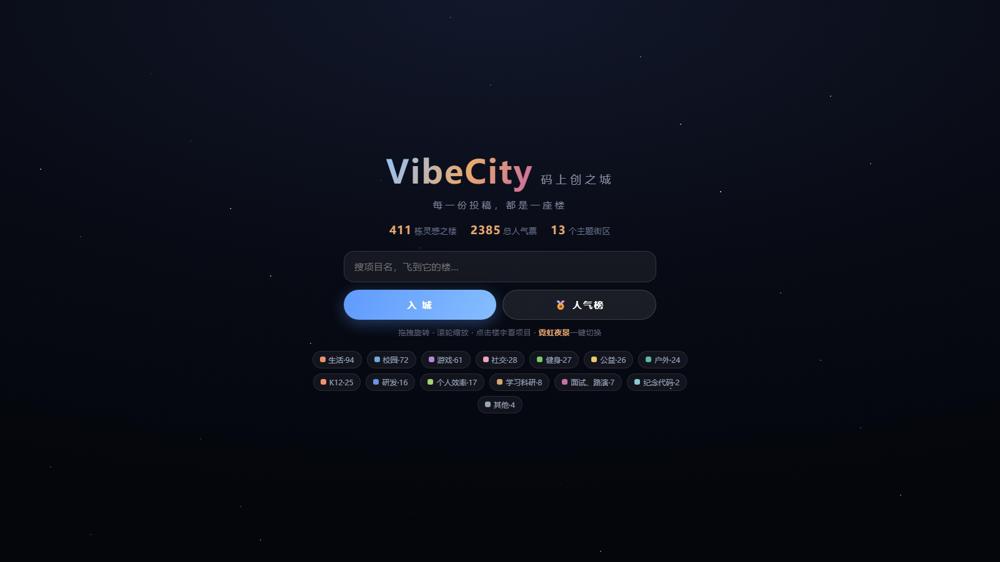
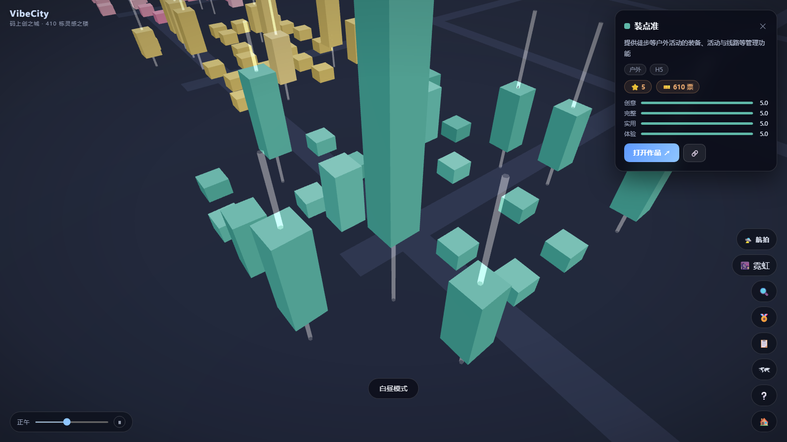
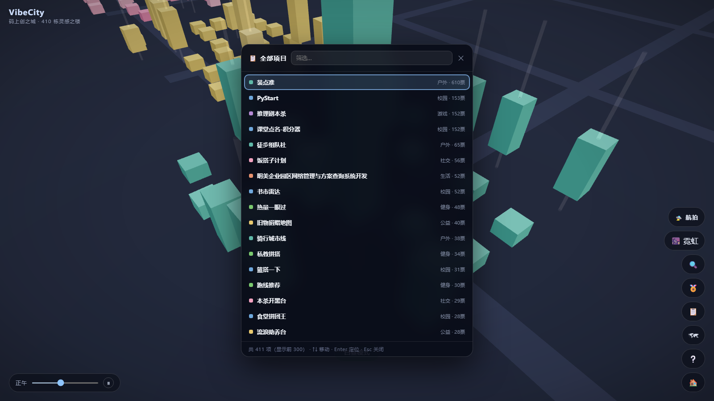
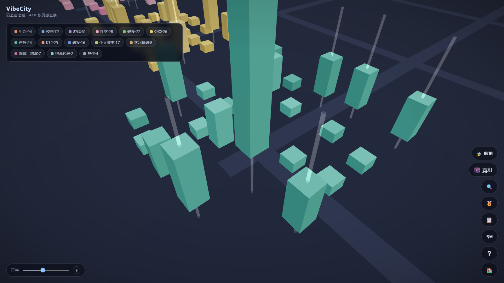

# VibeCity · 码上创之城

> **把 453 份大赛投稿，程序化生成一座可以走进去的 3D 城市。**
> 每个项目一栋楼，分类即街区，票数即楼高。走进 VibeCity，看见灵感的模样。

<p align="center">
  
</p>

---

## 这是什么

传统大赛作品墙是一页页平铺的卡片列表——**453 份灵感被压缩成缩略图，谁也记不住**。

VibeCity 把它们升维成一座城：

- **411 栋灵感之楼** —— 每个去重后的项目一棵楼。楼高 = `√(人气票) × 1.9 + 评分 × 2.4`
- **14 个主题街区** —— 生活 / 校园 / 游戏 / 社交 / 健身 / 公益 / 户外 / K12 / 研发 / 个人效率 …
- **26 类语义产业带** —— 街区内按「记账理财 / 学习答题 / AI 助手 …」聚类，相似项目自然相邻
- **Top60 beacon 光柱** —— 人气之楼顶上立一根全城可见的光柱
- **中心广场** —— 大赛纪念碑 + 旋转统计宝石

<p align="center">
  
  
</p>

---

## 关键体验

### 🌱 城市生长
入城时 411 栋楼**从地面长起**（实例化缩放插值 + easeOutCubic 缓动），像一座城正在被建成。

### 🌗 昼夜心跳
时间轴 `tod` 驱动一切：大气散射天空（Rayleigh 蓝光晕 + Mie 前向散射 + 日轮光晕）、方向光强度、雾色远近、beacon 呼吸。一轮约 52 秒，也可用滑杆定格任意时刻。

<p align="center">
  
</p>

### 🌆 霓虹夜景
一键切到赛博之夜：程序化窗灯矩阵（42% 窗格点亮）+ beacon 光柱增强 + 地面/道路压暗。

### 🏢 楼宇详情
点击任意楼宇弹出项目卡：**四维评分条**（创意 / 完整 / 实用 / 体验）、票数、分类、平台、直达作品链接，以及**一键复制定位深链**。

<p align="center">
  
</p>

### 📋 键盘可达的项目列表
`411` 个项目全量可浏览 —— `Tab` 聚焦 → `↑↓` 移动（屏幕阅读器播报项目名/分类/票数）→ `Enter` 飞行定位 → `Esc` 关闭；还带实时筛选。

<p align="center">
  
  
</p>

### 🗺 街区导览
14 个分类芯片，点击即飞往对应街区上空。

<p align="center">
  
</p>

---

## 操作指南

| 操作 | 说明 |
|---|---|
| **拖拽** | 旋转视角 |
| **滚轮 / 双指** | 缩放 |
| **右键拖拽** | 平移 |
| **单击楼宇** | 打开项目卡 |
| **🔍 搜索** | 输入项目名，相机飞行定位 |
| **🚶 漫游** | 第一人称：`WASD` 走动 · `空格` 跳 · `Esc` 回航拍 · 移动端自动出现虚拟摇杆 |
| **📋 列表** | 键盘可达的全部项目视图 |
| **🗺 导览** | 按分类飞行 |
| **🏅 排行** | 人气榜 Top 20，点击跳转对应楼宇 |
| **🌆 霓虹** | 白昼 / 夜景切换 |
| **⏸ 时间** | 昼夜自动流动开关 + 滑杆手动定格 |
| **F3** | 性能面板（FPS / draw calls / 三角面 / 几何与纹理内存） |
| **`?lite=1`** | 强制低配模式（低端设备逃生舱） |

---

## 技术架构

### 单文件离线应用
`index.html` **795 KB** —— 内联 three.js r160 + 业务代码 + 411 项目数据（72 KB）。
**双击即开，零外链、零 API、断网可用。**

> 刻意不使用 ES Module：`import`/`export` 在 `file://` 协议下会被 CORS 拦截，会破坏「双击即开」这一核心卖点。模块化改由**构建期契约校验**保证。

### 构建期三重校验
```
[build] JS 语法校验通过        (node --check)
[build] 模块契约校验通过       (顺序 02→03→04→05→06→07→08)
[build] 符号存在性校验通过     (拦截「调用未定义 VB.xxx」)
```

第三项是本项目真实收益：它拦下过「`VB.debounce` 未定义 → 整个 HUD 构建中断」这类致命错误。

### 渲染管线

| 层 | 技术 |
|---|---|
| **色彩** | ACES Filmic 色调映射 + sRGB 输出 + 曝光补偿 |
| **天空** | 单片 GLSL：Rayleigh 散射 + Mie 前向散射 + 太阳盘光晕 + 昼夜插值 + 夜间星点 |
| **城市** | 14 个街区各一个 `InstancedMesh`（411 栋楼 = **33 draw calls**） |
| **楼面** | Canvas 程序化窗格纹理 → `emissiveMap`（白昼玻璃幕墙 / 霓虹点亮） |
| **楼顶** | 天线 + 水塔实例化（各 1 个 draw call） |
| **地面** | PBR 材质 + 街区网格道路 |
| **拾取** | Raycaster 仅对楼体 Mesh，`instanceId → 项目索引`；带拖拽/飞行保护防误触 |
| **降级** | 设备信号自动低配；连续 2s <24fps 自动降 1x 像素比并停生长动画 |

### 性能实测
| 指标 | 数值 |
|---|---|
| Draw calls | **33**（411 栋楼 + 装饰 + 特效） |
| 三角面 | ~14k |
| 纹理数 | 1（程序化窗格，全楼共享） |
| 渲染分辨率 | 最高 2x DPR（可自适应降至 1x） |

---

## 数据管线

```
CSDN 公开接口 (vb.csdn.net/api/products?all=1)
        ↓  三通道容错（Node 直连 / 系统 curl / 默认通道）
   454 份原始投稿
        ↓  同名去重（取票数最高）
   411 个独特项目   →  73 KB 内联数据
        ↓  14 分类 + 26 语义组聚类
   src/03_data.js
```

**数据画像**（2026-11 抓取）：

| 维度 | 数值 |
|---|---|
| 独特项目 | 411 |
| 总票数 | 2,385 |
| 人气王 | 「装点准」610 票（徒步装备管理） |
| 分类 Top5 | 生活 94 · 校园 72 · 游戏 61 · 社交 28 · 健身 27 |
| 语义 Top5 | 游戏娱乐 71 · 学习答题 50 · AI 助手 43 · 运动健康 37 · 校园教务 28 |
| 语义覆盖率 | **88.8%**（「其他」仅 11.2%） |
| 带作品链接 | 411 / 411 |
| 带四维评分 | 122 |

### 一键刷新 + 自动部署

```bash
# 本地
node tools/refresh-data.js            # 刷新数据（--dry-run 只看统计）
python build.py && ./deploy.sh        # 重建并发布

# 服务器（已配置 cron，每 6 小时自动执行）
0 */6 * * * /opt/vb-city/refresh-and-deploy.sh
```

刷新脚本特性：三通道容错 · 去重取最高票 · 分类统计 · **脏数据超 20% 自动中止**（防止上游格式变更摧毁城市）。

---

## 自动化测试

**39 项 Playwright 端到端回归，全部通过，运行时 0 错误。**

```bash
python build.py       # 构建（含三重校验）
node tests/e2e.js     # 端到端回归
```

| # | 覆盖项 | # | 覆盖项 |
|---|---|---|---|
| 01 | 页面加载与启动页 | 21 | 移动端虚拟摇杆 |
| 02 | 入城与开场飞行 | 22 | F3 性能面板 |
| 03 | 渲染管线与性能 | 23 | 数据刷新脚本可执行性 |
| 04 | 昼夜心跳驱动 | 24 | 项目卡四维评分拆解 |
| 05 | 时间滑杆手动调节 | 25 | Esc 分级关闭优先级 |
| 06 | 楼体拾取与防误触 | 26 | 复制定位链接 |
| 07 | 搜索飞行定位 | 27 | 构建含模块契约校验 |
| 08 | 人气榜渲染与跳转 | 28 | 数据四维字段覆盖率 |
| 09 | 街区导览分类飞行 | 29 | 城市生长动画 |
| 10 | 白昼/霓虹切换 | 30 | 语义产业带聚类 |
| 11 | 漫游模式与键盘移动 | 31 | 语义相邻性验证 |
| 12 | 操作帮助面板 | 32 | 自适应降级机制 |
| 13 | 楼顶装饰实例化 | 33 | 低配下跳过生长动画 |
| 14 | 项目卡 XSS 转义 | 34 | 刷新数据后语义分组稳定 |
| 15 | hash 直达与非法输入拦截 | 35 | 语义覆盖率（其他类 <15%） |
| 16 | 数据完整性与一致性 | 36 | 项目列表视图 |
| 17 | 回到入口 | 37 | 列表键盘导航 |
| 18 | 移动端视口适配 | 38 | 列表筛选 |
| 19 | 全程无 JS 运行时错误 | 39 | 无障碍状态播报区 |
| 20 | 偏好持久化与刷新还原 | | |

---

## 安全

- **XSS 防护**：项目名 / 简介 / 链接等外部数据全部经 `escapeHtml` 转义后才进 DOM
- **hash 白名单**：深链直达限制长度 2–40、字符集白名单，拦截 `<script>` 等注入
- **CSP**：站点级 `default-src 'self'` + HSTS + `X-Frame-Options: SAMEORIGIN` + `nosniff`
- **纯前端**：无后端、无数据库、无用户数据上传

---

## 无障碍

- `role="dialog"` + `aria-modal` + `listbox`/`option` 语义的项目列表
- 键盘全通：`Tab` → `↑↓` → `Enter` → `Esc`
- `aria-live="polite"` 播报当前项目名、分类、票数
- `:focus-visible` 焦点环、`sr-only` 视觉隐藏类
- 支持系统「减弱动态效果」偏好（关闭生长动画）

---

## 目录结构

```
vb-city/
├── index.html                  # 构建产物（单文件应用，795 KB）
├── build.py                    # 构建：src/* + three.js → index.html（三重校验）
├── src/
│   ├── 01_style.css            # 深色都市风样式
│   ├── 02_tools.js             # VB 命名空间 + 工具 + 大气天空 shader
│   ├── 03_data.js              # 411 项目数据（由刷新脚本生成）
│   ├── 04_city.js              # 城市生成器：街区/实例化楼体/窗灯/beacon/生长/语义聚类
│   ├── 05_camera.js            # 航拍轨道 + 地面漫游 + 飞行定位
│   ├── 06_ui.js                # 启动页/HUD/项目卡/搜索/排行/导览/列表/帮助
│   ├── 07_main.js              # 渲染器/主循环/昼夜心跳/性能面板/启动容错
│   └── 08_prefs.js             # 偏好持久化（昼夜/霓虹/视角）
├── tests/e2e.js                # 39 项 Playwright 端到端回归
├── tools/
│   ├── refresh-data.js         # 数据刷新（三通道容错 + 健全性校验）
│   └── pixelcheck.js           # 截图像素验收（零依赖 PNG 解码）
├── vendor/three.min.js         # three.js r160（构建时内联）
└── shots/readme/               # README 截图
```

---

## 快速开始

```bash
# 1. 直接打开（无需安装任何东西）
双击 index.html

# 2. 本地开发
python -m http.server 8765
# 浏览器打开 http://127.0.0.1:8765/index.html

# 3. 构建
python build.py

# 4. 测试
node tests/e2e.js

# 5. 刷新数据
node tools/refresh-data.js
```

---

## 在线体验

**https://xn--888-vw3e05fxyzc07e.cn:9006/web/vb-city/**

---

## 设计思考

**为什么做这个？**

对 453 份投稿做量化分析后发现：**224 个项目在做「单项目内」的数据可视化，但没有一个把「大赛本身」作为可视化对象**。这份数据被埋在网格列表里——参赛者找不到自己的作品，评委看不完全貌，观众记不住任何东西。

VibeCity 补上这个空白：它既是**灵感索引**（点击楼体直达作品），也是大赛的**数字纪念园**（每位参赛者都能在城里找到属于自己的那栋楼）。

**楼高 = 人气，位置 = 分类，相邻 = 语义相近。** 空间本身成为信息。

---

## 许可

MIT License。所有项目名称、简介、评分、票数归 CSDN 码上创大赛及各作者所有；本项目仅作索引展示与直达链接。

three.js © three.js authors (MIT)。
